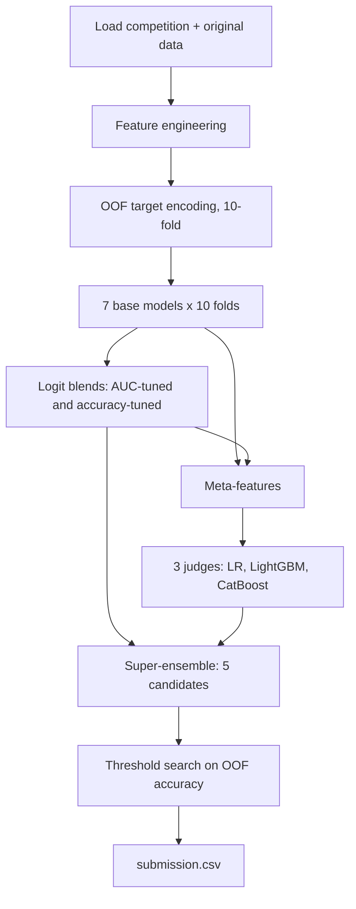

# Airline Passenger Satisfaction: GBDT + Neural + Stacking Pipeline (v3)

A Kaggle notebook for the **Playground Series S6E10** competition (`playground-series-s6e10`): predict whether an airline passenger was satisfied, given flight details and 14 survey ratings. The data is synthetic, generated from the public [Airline Passenger Satisfaction](https://www.kaggle.com/datasets/teejmahal20/airline-passenger-satisfaction) dataset.

The notebook trains seven models on 10 stratified folds, blends them in logit space, stacks them with three second-level "judge" models, and picks a threshold for accuracy. Training progress is checkpointed to a private Hugging Face repo after every fold so a killed Kaggle session loses nothing.

- Notebook: `prediction-airline-satisfaction_hf_ckpt.ipynb`
- Task: binary classification (`satisfaction`: 1 = satisfied, 0 = neutral or dissatisfied)
- Validation: 10-fold stratified CV, seed 42
- Metrics tracked: ROC AUC, accuracy, log-loss, precision, recall, F1

---

## What changed from v2

v2 plateaued at **0.9274 accuracy / 0.96124 AUC**. v3 targets the causes:

| Problem in v2 | Fix in v3 |
|---|---|
| Target encoding on the original-dataset rows (`X_extra`) used the full competition `y`, leaking validation labels into every fold. `og_lgb` / `og_cat` scored *below* `lgb` / `cat` and stopped early. | `X_extra` is target-encoded only from its own labels (5-fold OOF inside the original dataset). Added an `is_original` flag and a 0.5 sample weight for those rows. |
| Survey rating `0` ("not applicable") was averaged in as if it were a terrible score. | Non-zero (`NZ`) stats (mean, std, min, ranges, ratios), per-rating counts, and explicit `_is_zero` flags for wifi, online boarding, and online booking. |
| Rank averaging destroyed calibration, and `logit(rank)` fed garbage into the stacker. | Blending is done in logit space, so probabilities stay calibrated. |
| Only AUC was optimized, but accuracy depends on the exact decision boundary. | A second coordinate-ascent search tunes blend weights and threshold directly for OOF accuracy. |
| `RealMLP` hung for 40+ minutes spawning multi-GPU DDP subprocesses inside Jupyter. | Pinned to `cuda:0` with a `try/except` fallback, plus a fast custom PyTorch ResNet for neural diversity. |
| Single-smoothing 1-way/2-way target encoding. | Multi-granular OOF encoding (two smoothing levels, target std, weight of evidence) over 1-way, 2-way, and 3-way specs. |

---

## Pipeline



### 1. Feature engineering

Everything lives in `add_features`. Roughly 22 raw columns become a couple hundred features:

- **Frequency fingerprints:** counts of `Age`, `Flight Distance`, delays, and joint pairs across train + test (label-free), to catch generator density artifacts.
- **Distance, age, delay transforms:** log/sqrt, `% 10` and `% 100` of distance, haul flags, age bins, total/delta/ratio/per-mile delay, severe-delay flags, missing arrival-delay handling.
- **Survey features:** sub-indices (comfort, ground, digital, on-board), their differences, full and non-zero rating statistics, rating-value counts, high/low/mid counts, an all-satisfied flag.
- **Interactions:** products and differences of the top survey drivers, plus combined "code" columns (e.g. `Online boarding * 6 + Inflight wifi service`) that act as single categorical ids.
- **Cohort features:** differences and z-scores versus the passenger's (Class, Type of Travel, Customer Type) and (Age bin, Class) cohorts.

### 2. Out-of-fold target encoding

For each spec (10 single columns, 12 pairs, 4 triples; 83 columns), held-out folds are encoded using only the other nine folds. Test rows use full-train statistics. Smoothing follows `(n * cat_mean + m * global_mean) / (n + m)`.

Per spec, the code produces the main encoding (`m=20`), a lighter-smoothed version (`_m5`), a smoothed target std (`_std`), and weight of evidence (`_woe`).

### 3. Base models

| Name | Model | Notes |
|---|---|---|
| `xgb` | XGBoost (GPU `hist`) | depth 8, lr 0.005, up to 100k trees, early stopping 1000 on AUC |
| `lgb` | LightGBM | 111 leaves, depth 10, lr 0.005, `max_bin=4095` |
| `cat` | CatBoost | depth 7, lr 0.04, numeric columns treated as categorical, `max_ctr_complexity=4` |
| `og_lgb` | LightGBM + original data | original rows appended to each fold's training split, weight 0.5 |
| `og_cat` | CatBoost + original data | same as above |
| `resnet` | PyTorch tabular ResNet | entity embeddings, 3 residual blocks (256 hidden, BatchNorm, SiLU, dropout 0.2), AdamW + cosine schedule, 22 epochs, best-AUC epoch kept |
| `mlp` | `RealMLP_TD_Classifier` (pytabkit) | pinned to a single GPU, 25 epochs |

Every model early-stops on its own validation fold, writes OOF predictions for train, and averages its 10 fold-models for test.

### 4. Blending

Per-model OOF probabilities become logits. Weights come from:

1. Greedy hill-climb (up to 300 picks, with replacement) maximizing AUC.
2. SLSQP refinement minimizing log-loss; the better of the two by AUC is kept (`w_logit`).
3. Coordinate ascent over weights and threshold maximizing OOF accuracy (`w_acc`).

### 5. Stacking

`make_meta` builds a feature table from model logits, per-model confidence, pairwise logit differences, mean/std/median/range of logits, binary entropy, vote counts, and the raw features. Three judges train per fold:

- L2 logistic regression (`C=0.25`) on logit columns
- Shallow LightGBM (15 leaves, `min_child_samples=300`) on all meta-features
- Depth-4 CatBoost on logit columns

LightGBM and CatBoost judge logits are re-standardized to the blend's mean and std so they can be mixed.

### 6. Super-ensemble and submission

Five candidates (`blend`, `acc_blend`, `lr`, `gbm`, `cat_meta`) are combined by an AUC-optimized hill-climb (`super_auc`) and an accuracy-optimized coordinate ascent (`super_acc`). Each of the seven candidates gets a best-accuracy threshold from a 0.35-0.65 grid. The winner is selected by `SUBMISSION_TYPE`.

---

## Setup

### Environment

Designed for a Kaggle notebook with a GPU (tested layout: dual T4). It also runs on CPU, much more slowly.

```
pip install xgboost optuna catboost pytabkit
```

Also required (preinstalled on Kaggle): `pandas`, `numpy`, `scikit-learn`, `scipy`, `lightgbm`, `torch`, `joblib`, `kagglehub`, `huggingface_hub`.

### Data

The first cell downloads both datasets with `kagglehub`:

- `playground-series-s6e10` (competition files `train.csv`, `test.csv`)
- `teejmahal20/airline-passenger-satisfaction` (original data; if unavailable, the `og_*` models are skipped automatically)

### Hugging Face checkpoint sync

1. In Kaggle, go to **Add-ons → Secrets** and add `HF_TOKEN` (a token with **write** access).
2. Turn **Internet on** for the notebook.
3. Change `HF_REPO` to your own repo name. It is currently `sujalgawas/airline-satisfaction-ckpt` and is created as a private model repo if it doesn't exist.

If the token or network is missing, the notebook prints a warning and keeps checkpoints local only.

---

## Running

Run the notebook top to bottom. Key switches in the setup cell:

| Variable | Default | Meaning |
|---|---|---|
| `MODELS_ON` | all seven | Which base models to train |
| `SUBMISSION_TYPE` | `'proba'` | `'proba'`, `'calibrated_proba'`, or `'binary'` |
| `N_FOLDS` | `10` | Number of CV folds |
| `EXTRA_WEIGHT` | `0.50` | Sample weight for original-dataset rows |
| `USE_CKPT`, `CKPT_DIR` | `True`, `ckpt_v3` | Checkpointing on/off and location |
| `TRAIN_XGB`, `RESUME` | `True`, `False` | XGBoost training and warm-start behavior |

**Resuming a killed session:** rerun the notebook. Finished folds are restored from the Hugging Face repo and skipped.

**Picking a submission type:** use `'proba'` if the competition scores AUC, and `'binary'` or `'calibrated_proba'` if it scores accuracy. Check the competition's Evaluation tab before uploading.

---

## Outputs

| File | Contents |
|---|---|
| `submission.csv` | Predictions in the mode set by `SUBMISSION_TYPE` |
| `submission_calibrated_thr05.csv` | Probabilities shifted so the best OOF threshold maps to 0.50 |
| `submission_binary_acc.csv` | Hard 0/1 labels at the best OOF threshold |
| `ckpt_v3/` | Per-fold model checkpoints (`.pkl` / `.json`), mirrored to Hugging Face |


---

## Known limitations

- **OOF scores are optimistic.** Early stopping uses the validation fold, and blend weights, judges, and thresholds are tuned on the same OOF predictions. Expect the leaderboard to land somewhat below OOF.
- **XGBoost checkpoints are not hashed.** They're named `xgb_{N_FOLDS}f_fold{k}.json` with no config or feature hash (unlike the other models). If you change features, delete the old XGB files locally and on the Hugging Face repo, or they will load as-is and skip training.
- **Train/test mismatch in the stacker.** Judges train on single-model OOF predictions but score averages of 10 fold-models at test time. The per-set logit standardization partly compensates but assumes similar distributions.
- **Shared folds for encoding and modelling.** TE and models use the same 10 folds. This is a common setup with mild second-order leakage into training rows' encodings.
- **Docs vs. code drift.** Some markdown cells mention a `compute_extra_fold_te()` function and `m=10` / `m=50` smoothing. The code actually uses 5-fold OOF inside the original dataset and `m=20` / `m=5`.
- `optuna` is installed but not used.

---

## Acknowledgements

- Kaggle Playground Series S6E10
- Original dataset by [teejmahal20](https://www.kaggle.com/datasets/teejmahal20/airline-passenger-satisfaction)
- [pytabkit](https://github.com/dholzmueller/pytabkit) for `RealMLP`
